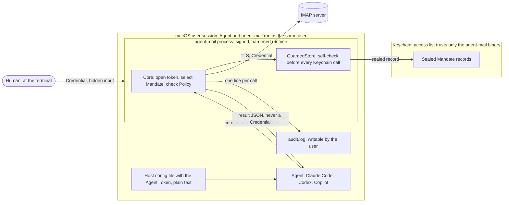
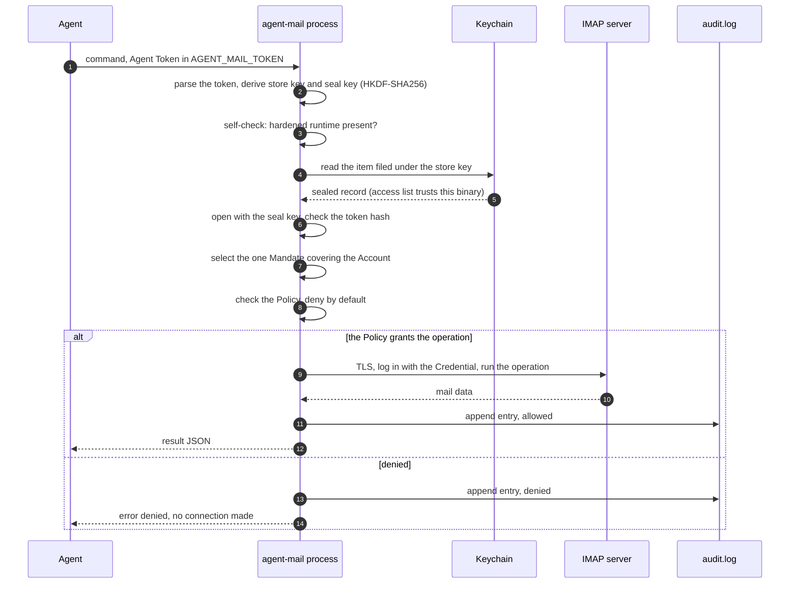
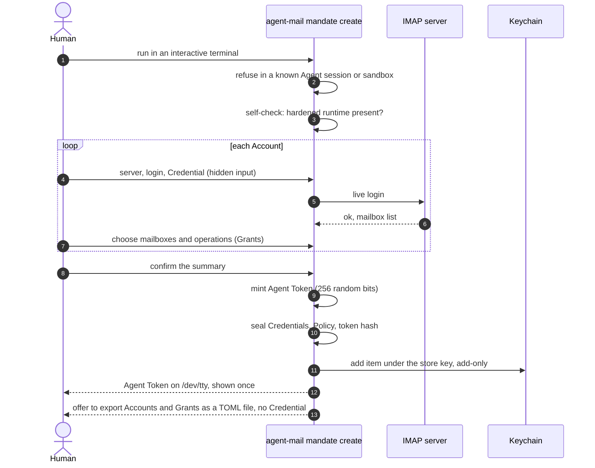

# Security concept: macOS

On macOS there is no background service ([ADR-0002](../adr/0002-no-background-service.md)). Every CLI call and every MCP server runs agent-mail in a process the Agent's host started, and that process enforces the Policy itself.

What keeps a hijacked Agent away from the Credential is the Keychain: its items trust only the agent-mail binary, and the binary refuses to touch them unless it runs with the hardened runtime. See the [overview](README.md) for what macOS and Windows share.

## Who holds what

| Party | Holds | Does not hold |
|---|---|---|
| The human | every Credential, typed once per Mandate; each Agent Token, shown once | nothing agent-mail hides from them |
| The Agent | its Agent Token, in `AGENT_MAIL_TOKEN` | any Credential, any sealed record's key |
| The Keychain | one sealed record per Mandate, service `agent-mail` | any Agent Token |
| agent-mail | the opened Mandate, in memory, for one call | anything after the call ends |
| The audit log | one metadata line per Agent mail operation | Credentials, tokens, message bodies |

The audit log is `~/Library/Application Support/agent-mail/audit.log`, mode `0600` in a `0700` folder, owned by the user.

The sealed record binds the Credentials, the Policy and the token hash together ([ADR-0003](../adr/0003-immutable-mandates.md)). Its key is derived from the Agent Token, so the Keychain item alone opens nothing.

## Trust boundaries

There are two boundaries. The Keychain access list separates the sealed records from every program but agent-mail. The hardened runtime separates the agent-mail process from code that would otherwise be injected into it, such as a library loaded with `DYLD_INSERT_LIBRARIES`.

The Agent and agent-mail run as the same user. The Agent can start agent-mail with any arguments and environment, but it cannot read agent-mail's Keychain items or change the running binary's code.

**The Keychain access list.** agent-mail creates each item itself through the Security framework, so the item's access list trusts only the agent-mail binary that created it. Items are add-only: an existing item and its access list are never updated.

**A changed binary.** Another program, or a changed agent-mail binary, gets a Keychain prompt instead of the item. Each release has a new ad-hoc signature, so the Keychain prompts once after each update; allow that one. A prompt at any other time is a red flag: deny it.

**The hardened-runtime self-check.** The release binary is signed with the hardened runtime, which refuses injected libraries. Before every Keychain call, `GuardedStore` reads the process's code-signing status with `csops` and refuses with `hardened_runtime_missing` if the runtime flag is missing.

The self-check is active only in macOS release builds. Nothing at runtime switches it off: no environment variable, argument, file or Cargo feature is read. Debug builds skip it, which is why the release profile pins `debug-assertions = false`.

## One Agent request

The Agent runs `agent-mail search`, or calls the same tool through `agent-mail mcp`, with its Agent Token in `AGENT_MAIL_TOKEN`. Everything happens inside that one process.

If the self-check fails, no Keychain call is made and the call fails with `hardened_runtime_missing`. A token that is malformed, unknown, or whose record does not open is ignored with an `invalid_token` warning; the other presented tokens still work.

When two presented Mandates cover the same Account, the call fails with `ambiguous_mandate` before any Grant check. If the audit entry cannot be written, the call fails with `audit_unavailable` and returns no result.

## `mandate create`

The human runs `agent-mail mandate create` in their own terminal. The checks below run before any prompt or store access.

- It needs an interactive terminal, else `interactive_terminal_required`.
- It refuses when it sees the environment of a known Agent session or sandbox, with `sandbox_detected`. This is best effort; the real barrier is the Credential.
- It runs the self-check first, so an unhardened binary never asks for a Credential it could not store.

Each Credential comes only from hidden input on the terminal: no flag, environment variable, pipe or Mandate file supplies one. A live login checks it. The Agent Token is written to `/dev/tty` once and never stored.

An Agent can run the same binary, but it cannot mint a broader Mandate: it does not know the Credentials, and the live login fails without them. To change a Policy, the human creates a new Mandate and deletes the old one.

## Protected against

- A hijacked Agent reading a Credential: the Keychain item opens only for the agent-mail binary, and agent-mail never prints, logs or returns a Credential.
- A hijacked Agent doing more than its Policy grants: every call checks the Policy of the one Mandate covering the Account, and anything not granted is denied.
- Code injected into agent-mail: the hardened runtime refuses it, and the self-check refuses the Keychain if the runtime is missing.
- A forged Policy: the sealed record binds Credential, Policy and token hash, and any change to the record or its listing makes it fail to open.
- Minting a Mandate: it needs every Credential, typed in an interactive terminal and checked by a live login.

## Not protected against

- An administrator or root: they can read process memory and change the system, so they are out of scope.
- A human who allows an unexpected Keychain prompt: that can hand a Credential to another program.
- Anyone holding the Agent Token: a token in a host config file is plain text, readable by every program of the same user, other Agents included. Whoever presents it can do what its Mandate grants.
- Deletion of a Mandate by a program of the same user; ADR-0003 accepts it.
- Changes to the audit log: it is written by agent-mail but owned by the user, so any program of the same user can read or change it.
- A replaced binary in `~/.local/bin`: the Keychain then prompts instead of serving it, so the defence is denying that prompt.
- Debug builds, which skip the self-check; use the signed release binary.
