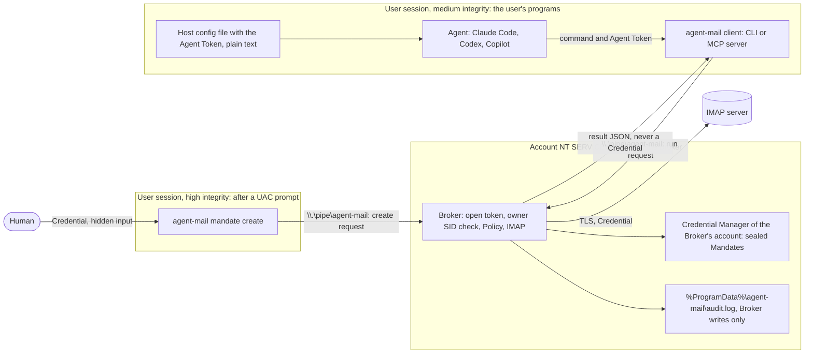
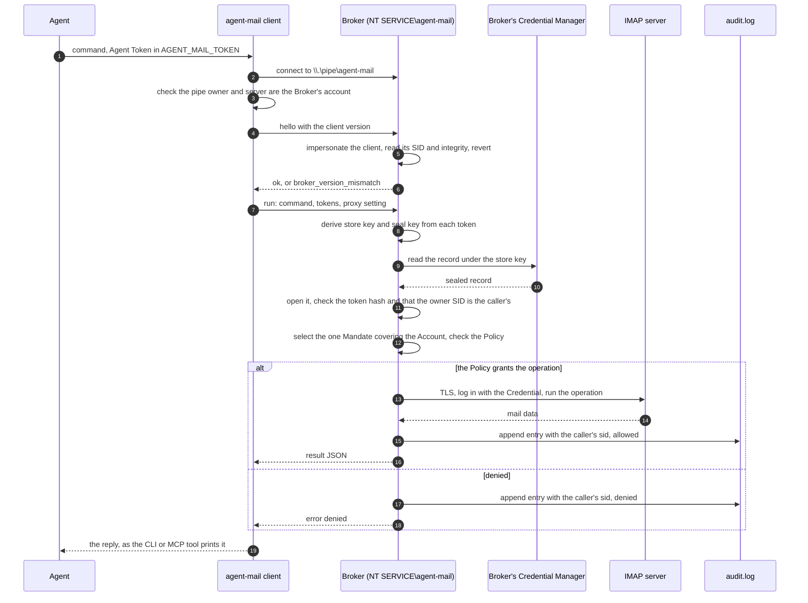
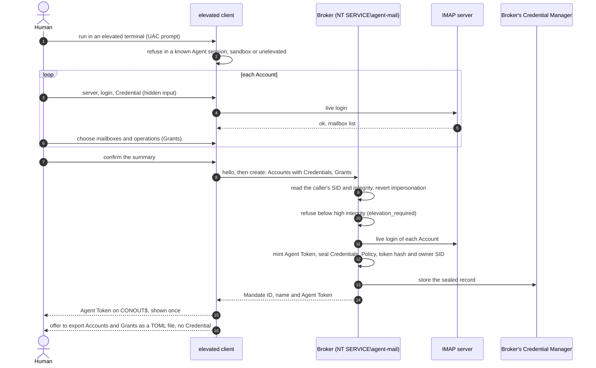

# Security concept: Windows

On Windows, Credential Manager and DPAPI let any program of the same user read that user's stored records. So agent-mail runs a Broker ([ADR-0004](../adr/0004-windows-broker.md)): the service `agent-mail`, running as the virtual account `NT SERVICE\agent-mail`.

The Broker holds the sealed Mandates and does every Agent's mail work itself. No Credential, sealed or not, ever leaves it. The CLI and the MCP server are thin clients. See the [overview](README.md) for what macOS and Windows share.

## Who holds what

| Party | Holds | Does not hold |
|---|---|---|
| The human | every Credential, typed once per Mandate; each Agent Token, shown once | nothing agent-mail hides from them |
| The Agent | its Agent Token, in `AGENT_MAIL_TOKEN` | any Credential, any sealed record |
| The client (`agent-mail`, `agent-mail mcp`) | the command, the presented tokens and the proxy setting, for one request | any sealed record; a Credential only while the human types it in `mandate create` |
| The Broker | the sealed Mandates, each with its owner's SID; the opened Mandate during one request | any Agent Token after the request ends |
| The audit log | one metadata line per Agent mail operation, with the caller's `sid` | Credentials, tokens, message bodies |

The Broker keeps the sealed records in its own account's Credential Manager, under target names `agent-mail:` plus the store key. The user's programs run under another account and cannot read them.

The audit log is `%ProgramData%\agent-mail\audit.log`. Its folder is owned by the Broker, writable only by the Broker and readable by Administrators.

The binary lives in `%ProgramFiles%\agent-mail`, which only administrators can change. A Broker binary the user could write would be a Broker a hijacked Agent could replace.

## Trust boundaries

The main boundary is the OS account boundary between the user, who runs the Agent and the client, and `NT SERVICE\agent-mail`, which runs the Broker. The only way across it is the named pipe `\\.\pipe\agent-mail`.

The second boundary is integrity: `mandate create` must run elevated, at high integrity. A same-user program at medium integrity, such as an Agent, cannot read an elevated process's memory or console, and cannot click the UAC prompt.

**The pipe.** Any authenticated local user can read and write it, but only the Broker can create instances of it, and remote clients are refused. The first instance is created with `FILE_FLAG_FIRST_PIPE_INSTANCE`, so a second Broker or a squatter cannot create the pipe while the Broker runs.

**The client's checks.** Before sending anything, the client checks that the pipe's owner is the SID of `NT SERVICE\agent-mail`, and that its server process runs as that account whenever it can read that. A pipe squatted while the Broker is stopped gives `broker_unavailable`.

**Every frame is untrusted.** Frames are length-prefixed JSON, at most 1 MiB; a longer one is refused with `invalid_request`. The first request must be `hello` with the client's version; a different version fails with `broker_version_mismatch` and the connection closes.

**The caller's identity.** The Broker learns the caller's SID and integrity from the pipe client's token, by impersonating it, never from the request. It reverts the impersonation before touching the store, IMAP or the audit log, and the process aborts if it cannot revert.

**The owner.** Each Mandate records the SID of the user who created it, bound to the sealed record. The Broker serves a Mandate only to a caller with that SID: another user's Mandate opens as an invalid token, and `mandate list` and `mandate delete` do not show it.

**The executable is not checked.** The Agent Token is the only thing that authorizes an operation. A hijacked Agent can start the real binary anyway, so checking the client's executable would add nothing.

## One Agent request

The Agent runs `agent-mail search`, or calls the same tool through `agent-mail mcp`, with its Agent Token in `AGENT_MAIL_TOKEN`. The client sends the request to the Broker and prints the reply exactly as an in-process run would.

A client that finds no pipe, a pipe that fails the identity check, or a reply it cannot read fails with `broker_unavailable`. A token whose record belongs to another SID is ignored like an unknown one, with an `invalid_token` warning.

`agent-mail audit` asks the Broker for the log, and gets only the entries carrying the caller's own SID.

## `mandate create`

The human runs `agent-mail mandate create` in an elevated terminal. The client checks before any prompt, connection or file read:

- It needs an interactive terminal, else `interactive_terminal_required`.
- It refuses when it sees the environment of a known Agent session or sandbox, with `sandbox_detected`. This is best effort.
- It needs to run elevated (`TokenElevation`), else `elevation_required`. This check is a convenience; the Broker checks again.

The client asks for each Credential with hidden input and checks it with a live login. It then sends the whole Mandate in one `create` request. The Broker refuses `create` from a caller below high integrity with `elevation_required`, before any login or store access.

The elevated terminal keeps the Credential safe while it is typed, and the UAC prompt is a confirmation an Agent cannot click. `mandate list` and `mandate delete` need no elevation.

## Protected against

- A hijacked Agent reading a Credential: the sealed records live in the Broker's account, and no reply carries a Credential or a sealed record.
- A hijacked Agent doing more than its Policy grants: the Broker checks the Policy of the one Mandate covering the Account, and anything not granted is denied.
- A hijacked Agent minting a Mandate: it needs every Credential, an elevated terminal and a UAC confirmation.
- Another Windows user using or deleting your Mandates: the Broker serves each Mandate only to its owner's SID, even with the right Agent Token.
- A fake Broker: a pipe not owned and served by `NT SERVICE\agent-mail` is refused before anything is sent.
- A replaced Broker binary: `%ProgramFiles%\agent-mail` is writable by administrators only.
- Changes to the audit log by the user's programs: only the Broker can write it, and the Broker refuses a log folder that is a link or that others can write.
- A forged Policy: the sealed record binds Credential, Policy, token hash and owner SID ([ADR-0003](../adr/0003-immutable-mandates.md)).

## Not protected against

- An administrator: they can run code as the Broker's account, read its memory and stores, or install another binary, so they are out of scope. An Agent that runs elevated is an administrator too.
- Anyone holding the Agent Token from the owner's account: a token in a host config file is plain text, readable by every program of the same user, other Agents included. Whoever presents it can do what its Mandate grants.
- Deletion of a Mandate by a program of its owner; [ADR-0003](../adr/0003-immutable-mandates.md) accepts it.
- A stopped Broker: the clients then fail with `broker_unavailable`, and nothing works until it runs again.
- Anything the mail provider sees or allows under the granted operations.
